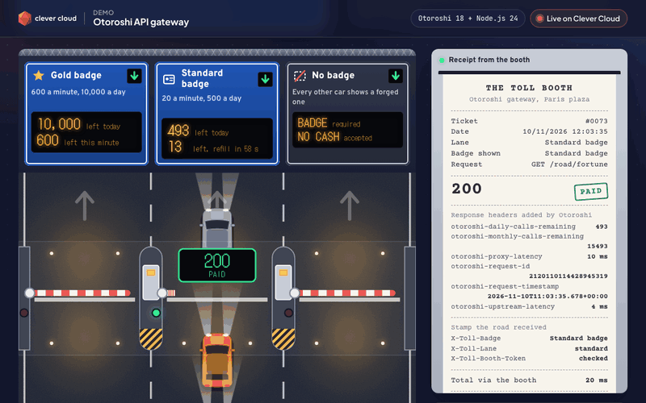
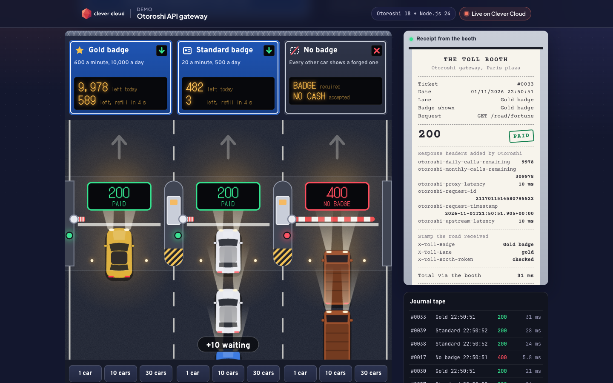
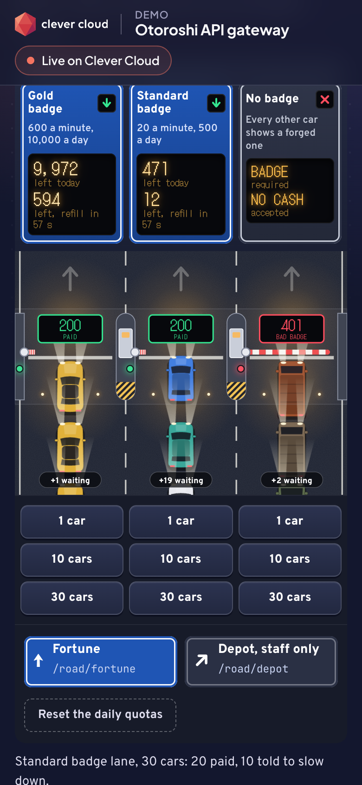

# The Toll Booth: Otoroshi API gateway on Clever Cloud

> A motorway toll plaza for APIs. Three lanes of cars drive to a tiny API, "the road", and every one of them stops at **Otoroshi** first. The gold badge sails through, the standard badge gets told to slow down after 20 trips a minute, and cars without a valid badge are turned away. Each answer prints a receipt with the headers Otoroshi added. One small Node.js app, no framework, no dependency, the Otoroshi add-on configured through its admin API, deployed on Clever Cloud.







**Run it yourself.** A live copy runs at <https://app-974b8d95-1d2c-4da7-aac2-c29d4de8b485.cleverapps.io/> (redeployed on 2026-11-10; it may be stopped between demos). The steps in [Deploy on Clever Cloud](#deploy-on-clever-cloud) recreate it from scratch in about 15 minutes, most of it waiting for Otoroshi to start.

**Get certified.** This demo runs on Clever Cloud. To deploy your own apps the same way, get certified at the [Clever Cloud Academy](https://academy.clever.cloud/).

## What Otoroshi does here

The app is both the backend ("the road", `GET /road/*`) and the dashboard. The dashboard never talks to Otoroshi from the browser: it asks the app to drive cars, and the app calls the gateway server-side, so the badges' secrets never reach the browser.

```
browser ──POST /api/drive──▶ app (dashboard) ──GET /road/fortune + badge──▶ Otoroshi route ──stamped request──▶ app (the road)
                                     ▲                                          │
                                     └────────── status + otoroshi-* headers ◀──┘
```

One Otoroshi route, `toll-booth-road`, applies five plugins in order:

| # | Plugin | What it does in the demo |
|---|---|---|
| 1 | `OverrideHost` | Calls the road with the road's own `Host`, so Clever Cloud routes it to the right app |
| 2 | `ApikeyCalls` | No badge, no entry: reads `Otoroshi-Client-Id` / `Otoroshi-Client-Secret` (or Basic auth) and counts the call against the badge's quotas |
| 3 | `RoutingRestrictions` | The path rule: anything under `/road/depot` answers **403**, whatever the badge |
| 4 | `AdditionalHeadersIn` | The stamp: adds a secret `X-Toll-Booth-Token`, plus `X-Toll-Badge: ${apikey.name}` and `X-Toll-Lane: ${apikey.metadata.lane}`. The road refuses any request without the token, so it is only reachable through the booth |
| 5 | `SendOtoroshiHeadersBack` | The receipt: `otoroshi-request-id`, `otoroshi-proxy-latency`, `otoroshi-upstream-latency`, `otoroshi-daily-calls-remaining`… on every response |

Two API keys, the badges, with a `FixedWindowStrategyConfig` throttling strategy:

| Badge | Client id | Rate limit | Daily quota |
|---|---|---|---|
| Gold | `toll-booth-gold` | 600 calls per minute | 10,000 |
| Standard | `toll-booth-standard` | 20 calls per minute | 500 |
| No badge | (none, or a forged gold badge on every other car) | answered 400 `no apikey` / 401 `bad apikey` | |

What you see on the page:

- **Gantry signs**: the calls left today, read from Otoroshi's `otoroshi-daily-calls-remaining` header after every trip (and from `GET /api/apikeys/:id/quotas` on load); the calls left this minute with a refill countdown.
- **The plaza**: green light and barrier up for 200, red for 400/401/403, orange "slow down" with hazard lights for 429.
- **The receipt and journal tape**: status, every `otoroshi-*` response header, the stamp the road received, the total latency through the booth.
- **What the booth costs in time**: median latency through the gateway, Otoroshi's own share (`otoroshi-proxy-latency`), and the same road called directly.
- **The rules**: the route and the two badges, read live from the admin API (token and secrets hidden).
- **Reset the daily quotas**: `DELETE /api/apikeys/:id/quotas` on both badges.

The app configures Otoroshi itself at every boot (`ensureBooth()` in `src/booth.js`: create or update the route and both badges, idempotent), then drives one car per lane so the first screen is never empty. `npm run setup` runs the same code by hand.

## Deploy on Clever Cloud

Two pieces, linked together:

- **the app** `demo-otoroshi-gateway` (Node.js): the road, the dashboard and the page;
- **the Otoroshi add-on** `demo-otoroshi-gateway-booth`, which Clever Cloud runs as its own Java app and Redis. Its admin API is how the app configures the gateway; its routes domain is the gateway the cars drive through.

The link is `clever service link-addon`. The gateway reaches the road on the app's public domain, `https://app-<id>.cleverapps.io`, which the app derives from its own `APP_ID` (set `ROAD_URL` if you serve it elsewhere).

You need [clever-tools](https://www.clever.cloud/developers/doc/cli/) (`clever login` done), `jq`, and the ID of the organisation that will own the resources (`orga_…`, shown in the Console). Run the commands from the repo root: `clever create` links the folder to the new app.

```bash
# 1. The app and its size
clever create --type node demo-otoroshi-gateway --org <org_id> --region par
clever scale --min-flavor nano --max-flavor XS --min-instances 1 --max-instances 2
clever scale --build-flavor M

# 2. Otoroshi (plan base; the provider offers no encryption option), linked to the app.
# `clever addon create` prints the Otoroshi admin credentials, once: its output is a secret.
# Never record or share it (terminal recording, screen share, pasted log). Here it is not shown: only the add-on ID is kept.
OTO_ID=$(clever addon create otoroshi demo-otoroshi-gateway-booth --plan base --org <org_id> --region par 2>&1 | grep -oE 'addon_[0-9a-f-]+' | head -1)
echo "${OTO_ID:?add-on not created: list the add-ons with clever addon list --org <org_id>}"   # the ID only, not a secret
clever service link-addon demo-otoroshi-gateway-booth --alias demo-otoroshi-gateway

# 3. The road's secret: generated here, never printed
clever env set ROAD_TOKEN "$(openssl rand -hex 24)" >/dev/null
clever env set CC_HEALTH_CHECK_PATH /health
```

Linking the add-on should inject `CC_OTOROSHI_API_URL`, `CC_OTOROSHI_API_CLIENT_ID` and `CC_OTOROSHI_API_CLIENT_SECRET`. Check the names (not the values) with `clever env | grep -oE '^CC_OTOROSHI[A-Z_]*='`. With Otoroshi 18.0.1 (November 2026) linking injected none of them, so set them on the app yourself, without printing a value.

The add-on does not expose them either: `clever addon env "$OTO_ID" -F shell` prints nothing for an Otoroshi add-on (18.0.1, replayed on Clever Cloud on 2026-11-10). Read the three values from the add-on details and set them without printing them:

```bash
clever features enable operators
OTO=$(clever otoroshi get demo-otoroshi-gateway-booth --format json)
clever env set CC_OTOROSHI_API_URL "$(jq -r .api.url <<<"$OTO")" --alias demo-otoroshi-gateway >/dev/null
clever env set CC_OTOROSHI_API_CLIENT_ID "$(jq -r .api.user <<<"$OTO")" --alias demo-otoroshi-gateway >/dev/null
clever env set CC_OTOROSHI_API_CLIENT_SECRET "$(jq -r .api.secret <<<"$OTO")" --alias demo-otoroshi-gateway >/dev/null
unset OTO
```

Then deploy:

```bash
# 4. Deploy
clever deploy
clever open
```

There is no setup script to run: at every boot the app configures Otoroshi itself (`ensureBooth()`: the route `toll-booth-road` and the two badges, idempotent). The logs then show `[booth] route toll-booth-road and 2 badges ready, gateway https://<gateway-domain>`, and `GET /health/deep` answers 200 once the route and badges exist. `npm run setup` runs the same code by hand.

Demo sizing: `nano` to `XS`, 1 to 2 instances, dedicated `M` build. The Otoroshi add-on (plan `base`, one Java app and one Redis) costs about €37 per 30 days: delete it after the demo and recreate it with the commands above when needed.

## Variables

| Variable | Set by | Role |
|---|---|---|
| `CC_OTOROSHI_API_URL`, `CC_OTOROSHI_API_CLIENT_ID`, `CC_OTOROSHI_API_CLIENT_SECRET` | the Otoroshi add-on (see above) | Admin API of the gateway: route, badges, quotas |
| `ROAD_TOKEN` | you, random (`openssl rand -hex 24`) | Secret the booth adds to every request; the road refuses requests without it |
| `ROAD_URL` | optional | Public URL of the road. Default: the app's own `https://app-<id>.cleverapps.io`, derived from `APP_ID` |
| `GATEWAY_URL` | optional | Public URL of the gateway. Default: the routes domain of the add-on, read from Otoroshi |
| `PORT` | Clever Cloud | 8080 |

The "Running on Clever Cloud" panel shows only `CC_APP_NAME`, `APP_ID`, `INSTANCE_NUMBER`, `INSTANCE_TYPE`, `CC_PRETTY_INSTANCE_NAME`, `CC_COMMIT_ID` and `CC_DEPLOYMENT_ID`.

## Routes

| Route | Role |
|---|---|
| `GET /` | The plaza |
| `GET /road/fortune`, `GET /road/depot` | The road: a travel fortune for a fictional town. 403 without the booth's token |
| `POST /api/drive` | `{"lane": "vip"\|"standard"\|"none", "count": 1\|10\|30, "exit": "fortune"\|"depot"}`: drives the cars through Otoroshi, answers one JSON line per car (NDJSON), then a latency summary |
| `GET /api/state`, `GET /api/quotas` | Live route, badges and quotas from the admin API, recent receipts, platform panel |
| `POST /api/reset` | Resets the daily quotas of both badges |
| `GET /health` | 200, does not touch the add-on |
| `GET /health/deep` | 200 when the admin API answers and the route and badges exist, 503 otherwise |

Try the booth from a terminal:

```bash
curl -i https://<gateway-domain>/road/fortune                       # 400, no badge
curl -i https://<app-domain>/road/fortune                           # 403, the road only trusts the booth
curl -s -X POST https://<app-domain>/api/drive -d '{"lane":"standard","count":30,"exit":"fortune"}'   # 20 paid, then 429
```

## Local development

Node.js 24. Otoroshi cannot reach your laptop, so point the booth at a deployed road:

```bash
export CC_OTOROSHI_API_URL=… CC_OTOROSHI_API_CLIENT_ID=… CC_OTOROSHI_API_CLIENT_SECRET=…
export ROAD_URL=https://app-<id>.cleverapps.io ROAD_TOKEN=<same as the deployed app>
PORT=8130 npm start
npm test          # 22 tests, no network: road, booth config, fake admin API, windows, HTTP routes
```

## Project structure

```
server.js              HTTP server: page, road, dashboard API, boot-time booth setup
src/booth.js           Otoroshi admin API client, the route and badges, ensureBooth(), quotas
src/drive.js           sends cars through the booth or straight to the road, keeps otoroshi-* headers
src/road.js            the road: fortunes, token check
src/windows.js         the minute window of each badge, followed from the gateway's answers
src/config.js          environment variables, platform panel allow-list
scripts/setup-booth.js npm run setup: configure Otoroshi by hand
public/                index.html (plaza SVG), app.js (animation, receipts), style.css, cc-brand.css (Clever Brand Kit, unchanged)
test/                  node --test
```

## Known limits

- **Minute counter.** Otoroshi enforces the 20-calls-a-minute window (it answers 429), but on 18.0.1 its quotas endpoint reports 0 calls for the `FixedWindowStrategyConfig` window, and resetting quotas does not clear it. The "left this minute" counter is therefore followed by the app from the gateway's answers (`src/windows.js`); "left today" comes from Otoroshi.
- The fixed window is counted per Otoroshi instance (the `base` plan runs one).
- Receipts are kept in memory per app instance (the last 24).
- The road is a public app protected by a shared token. In production, put the backend on a private network (the add-on supports Network Groups) or use Otoroshi's challenge protocol.

MIT License, Copyright (c) 2026 Vitiosum.
